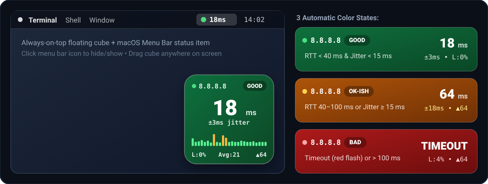
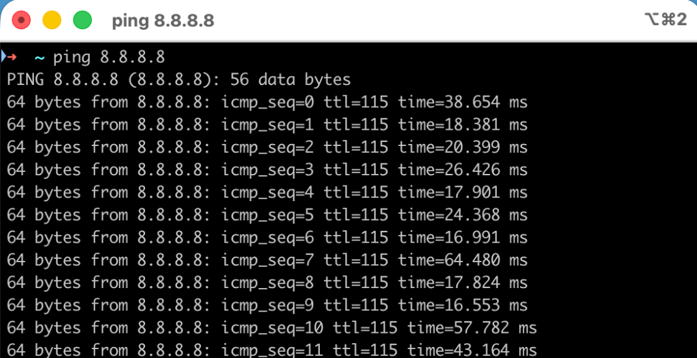

# PingCube

A tiny, always-on-top connectivity cube and macOS Menu Bar monitor that replaces a continuous `ping 8.8.8.8` terminal window with at-a-glance RTT latency, jitter, packet loss, and a 25-ping color-coded sparkline.



### Why?
Instead of keeping a terminal window running `ping 8.8.8.8` open all day to spot Wi-Fi/ISP latency spikes or dropped packets:

<p align="left">
  
</p>

**PingCube** stays tucked in the corner of your screen (and macOS Menu Bar) using almost zero memory:
- **Green (`GOOD`)**: RTT `< 40 ms`, jitter `< 15 ms`, `0%` recent packet loss
- **Orange (`OK-ISH`)**: RTT `40–100 ms`, jitter `>= 15 ms`, or recovering from a recent drop
- **Red (`BAD` / `TIMEOUT`)**: RTT `> 100 ms` or packet timeout (flashes bright red on packet loss)

---

## Option 1: Native macOS App (`PingCube.swift`)

Zero dependencies, ~20 MB RAM, borderless `138×138 px` floating cube across all macOS Spaces + live Menu Bar indicator (`🟢 18ms`).

```bash
# Compile standalone binary:
swiftc -O PingCube.swift -o PingCube
./PingCube

# Or build a double-clickable PingCube.app bundle (no Dock / Cmd+Tab icon):
./build_mac_app.sh
open PingCube.app
```

- **Left-click** the Menu Bar item (`🟢 18ms`) to hide/show the floating cube.
- **Right-click** the Menu Bar item or the cube itself to Pause/Resume, Reset 60s stats, or Quit.
- **Drag** anywhere on the cube to reposition it.

---

## Option 2: Terminal TUI Cube (`ping_cube.py`)

Zero dependencies (Python 3 standard library), ~5 MB RAM, works on macOS and Linux.

```bash
python3 ping_cube.py
```

- **Hotkeys**: `p` Pause/Resume · `r` Reset stats · `q` Quit

---

## Custom Thresholds & Target Host

Both versions accept the same flags:

```bash
./PingCube --host 8.8.8.8 --warn 40 --bad 100 --jitter-warn 15
python3 ping_cube.py --host 8.8.8.8 --warn 40 --bad 100 --jitter-warn 15
```
